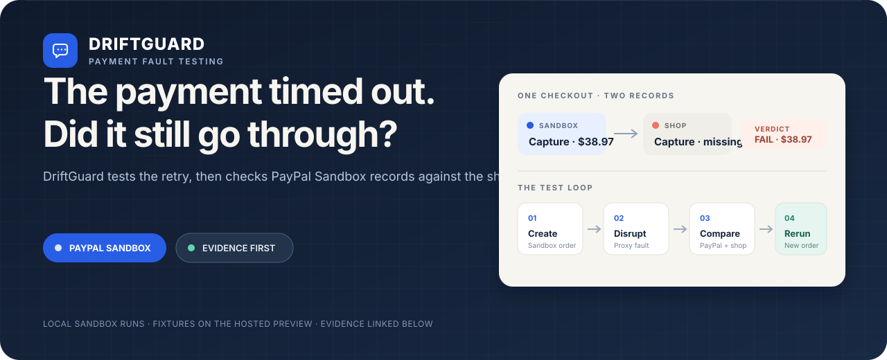

<p align="center">
  
</p>

<p align="center">
  <a href="https://driftguard-dashboard.onrender.com">Hosted explorer</a> ·
  <a href="evals/fixer/results/live-fixer-eval.md">Sandbox evidence</a> ·
  <a href="docs/devpost.md">Project story</a> ·
  <a href="LICENSE">MIT License</a>
</p>

<p align="center"><strong>PayPal AI Hackathon · Team Pixentropy</strong></p>

---

## Why DriftGuard exists

A payment request can reach PayPal while its success response disappears on the way back. The shop sees a timeout and has to decide whether to retry. Retrying blindly can create a second order; treating the timeout as a failure can leave a paid order unfulfilled.

DriftGuard recreates that failure against a deliberately vulnerable shop in **PayPal Sandbox**. It compares the Sandbox order with the shop's own record, then checks a proposed repair against a fresh order.

## Evidence from the demo shop

| Fault | What the first run exposed | Curated patch rerun |
|:--|:--|:--|
| **F1 · lost capture response** | PayPal captured; the shop missed the response | PASS · one capture recorded by both |
| **F2 · simulated gateway timeout** | A blind retry created two Sandbox orders | PASS · one order and one capture |
| **F3 · declined instrument** | The shop recorded success after PayPal declined | PASS · no capture on either side |
| **F4 · invoice response fault** | The shop lost its capture record after a simulated response error | PASS · one capture recorded by both |
| **F5 · tax rounding** | Shop total was $38.92; PayPal captured $38.92 against $38.96 expected | PASS · fresh order captured $38.96 |
| **F6 · webhook replay** | Same event was delivered twice to the shop | PASS · patched shop processed the event once |
| **F7 · refund prompt injection** | Shop recorded a $500 refund request; PayPal recorded no refund | PASS · guard rejected it; no refund recorded |

These results are seven local Sandbox runs, one curated-patch rerun per fault. For F5–F7, each row represents a fresh failed parent and a patched child using a distinct Sandbox order. The [evaluation record](evals/fixer/results/live-fixer-eval.md) contains the parent and child run IDs, PayPal evidence, and patch hashes. This is evidence for the seeded demo shop; it is not a model success rate or a study of other merchants.

F4 simulates an invoice response failure; it does not reproduce PayPal's own duplicate-invoice rejection. F6 tests whether the shop processes one webhook event twice; replay does not create another PayPal capture. F7's attack and guard are shop-state behavior; the demo does not call PayPal's refund API.

## The test, step by step

| 01 · Create | 02 · Disrupt | 03 · Compare | 04 · Rerun |
|:--|:--|:--|:--|
| Playwright approves a real Sandbox order as a test buyer. | mitmproxy delays or changes the response selected by the fault scenario. | The reconciler reads PayPal order evidence and the shop's per-order state. | A curated or model-proposed patch is applied to a temporary shop copy; a fresh order checks the behavior again. |

```text
PayPal Sandbox  ⇄  mitmproxy  ⇄  demo shop
                                      │
Playwright buyer ──► run engine ──► reconciler ──► saved run ──► dashboard
                                      ▲
                      patched shop copy + fresh order
```

The reconciler decides PASS, FAIL, or ERROR from observed state. The model can suggest a patch or explain a result; it does not decide the verdict.

## Run it locally

The hosted site is a fixture explorer. For a real Sandbox checkout, use the local setup below. You need Python, Node.js/npm, Docker Desktop, PayPal Sandbox REST credentials, and a Sandbox buyer account. Playwright needs its Chromium browser installed.

Copy `.env.example` to `.env`; fill in `PAYPAL_CLIENT_ID`, `PAYPAL_CLIENT_SECRET`, `PAYPAL_SANDBOX_BUYER_EMAIL`, and `PAYPAL_SANDBOX_BUYER_PASSWORD`. Keep that file on your machine.

From the repository root, install the dependencies and start the proxy/database containers:

```powershell
python -m pip install -r engine/requirements.txt
python -m pip install -r ai/fixer/requirements.txt
python -m playwright install chromium
npm install --prefix targets/demo-shop
npm install --prefix dashboard
docker compose up -d
```

Start these four processes in separate terminals:

```powershell
python -m uvicorn engine.api.main:app --port 8000 --reload
python -m uvicorn ai.service.app:app --port 8001 --reload
npm --prefix targets/demo-shop run dev
npm --prefix dashboard run dev
```

Open `http://localhost:5173/` for the landing page and `http://localhost:5173/live` for engine runs. From another terminal, run:

```powershell
python -m cli run F1
python -m cli report --all
```

The first command returns a nonzero exit code when the seeded bug is found: `1` means FAIL and `2` means ERROR or no verdict. PostgreSQL is used when available; the API reports a persistent SQLite fallback if it cannot connect. The active proxy fault is shared, so run scenarios one at a time.

The Studio service on port 8001 needs `ANTHROPIC_API_KEY` for Claude replies. Without a model key, Studio can show prepared preview answers; local run execution and reconciliation do not need a model key. The dashboard reads `VITE_API_URL` and `VITE_AI_URL` from `dashboard/.env.local` when you use non-default addresses. Never put PayPal or model secrets in `VITE_` variables.

### Verify a patch locally

Patch execution is opt-in because it runs Node code. In `.env`, set:

```dotenv
DRIFTGUARD_ENABLE_FIX_RERUN=1
DRIFTGUARD_LLM=none
```

Restart the engine, open a failed run, and choose **Generate and verify fix**. With `DRIFTGUARD_LLM=none`, the fixer selects a curated patch. The engine applies it to a disposable copy, builds that copy, and tests a new Sandbox order. Keep this option off on public services; the temporary directory is not a security sandbox.

## Hosted explorer

The [Render site](https://driftguard-dashboard.onrender.com) uses `mock_runner`, which serves contract fixtures and prepared outcomes. Its run, fix, and verify controls let visitors explore the interface; they do not run Playwright, mitmproxy, patch code, or make a new PayPal payment. Responses are labeled `mode: "sample"` in the dashboard.

The hosted API can call Anthropic if `ANTHROPIC_API_KEY` is set as a Render secret. Put an account or workspace spend limit in Anthropic Console before adding the key. The service's in-memory request limits reset on restart and do not cap billing. Without the key, Studio returns a prepared answer and identifies it as a preview.

## Project map

| Path | Purpose |
|:--|:--|
| `engine/` | FastAPI run API, orchestration, proxy rules, and deterministic reconciliation |
| `targets/demo-shop/` | Deliberately vulnerable TypeScript checkout used as the test target |
| `targets/known-fixes/` | Curated patches used by offline verification |
| `ai/` | Buyer driver, pattern-based scanner, scenario generator, fixer, and explainer |
| `contracts/` | Scenario/result schemas plus examples; fixtures are not live payment evidence |
| `dashboard/` | React interface, AG Grid run table, and AG Studio canvas |
| `mock_runner/` | Fixture-backed API for the hosted explorer |
| `evals/` | Automated checks and saved evaluation artifacts |

The scanner currently uses source patterns, not Tree-sitter. The demonstrated live path covers PayPal Orders create/capture and order evidence. Webhook signature verification, real PayPal refunds, and real duplicate-invoice rejection are outside the saved proof. The [study data](study/methodology.md) is exploratory annotation data; the repository does not contain enough source and run records to support population statistics.

## Team

| Teammate | Focus |
|:--|:--|
| [Swastik Bose](https://github.com/VasuBhakt) | Engine and reconciliation |
| [Kiran Patra](https://github.com/patrakiran) | Scenarios and demo shop |
| [Prathamesh Prasad](https://github.com/Prathamesh51-debug) | Fixer, dashboard, and buyer driver |

The [ownership map](docs/repo-ownership.md) describes review boundaries. The [planner](docs/planner.md) is historical; it records intended work, not current feature status.
