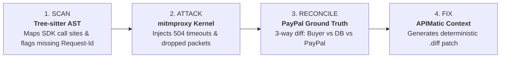

# DriftGuard

**The autonomous chaos-testing and sandbox ledger-reconciliation harness for AI payment agents.**  
Built for the PayPal AI Hackathon 2026.

[](https://paypalaihackathon.devpost.com/)
[](#)
[](#)

## The Problem
Wiring language models to payment APIs introduces subtle, high-severity distributed systems bugs that mocked unit tests miss. When an AI agent drops an HTTP packet mid-capture, rounds a fractional tax calculation by $0.04, or receives a spoofed dispute webhook, it drifts from reality. The agent tells the user one thing, the local database records another, and the PayPal ledger reflects a third—often resulting in catastrophic double-charges or unauthorized refunds.

## What DriftGuard Does
DriftGuard is a live runtime fuzzer and MITM fault-injector for `api-m.sandbox.paypal.com`. It intercepts live sandbox traffic from your AI application, injects real-world network and semantic faults, and mathematically proves whether your agent's deterministic guardrails hold. 



### The Developer Workflow
1. **Scan:** Parses your repository's AST (`ai.scanner`) to map PayPal SDK call sites (`Orders v2`, `Invoicing v2`, `Webhooks`) and detect missing idempotency headers, blind retry loops, or unverified signatures.
2. **Attack:** A reverse proxy (`engine.proxy`) intercepts live Sandbox calls without code changes, injecting 504 Gateway Timeouts, duplicate invoices, and network drops mid-capture.
3. **Reconcile:** Bypasses local application databases to query PayPal's Sandbox Ground Truth directly, calculating a 3-way reconciliation (Buyer UI vs App Database vs PayPal Ledger) displayed in an interactive AG Grid dashboard.
4. **Fix:** Leverages APIMatic SDK specifications and AST rewriting (`ai.fixer`) to synthesize drop-in code patches (e.g. deterministic SHA-256 `PayPal-Request-Id` derived from stable cart & order fields), applies them to a disposable shop copy, and reruns the fault to turn the matrix from **RED** to **GREEN**.

## Load-Bearing Tech Stack
* **PayPal APIs:** `Orders v2`, `Invoicing v2`, `Captures Refund API`, `Transaction Search`, `verify-webhook-signature`.
* **Execution Kernel:** `mitmproxy` (fault injection), PostgreSQL (`SKIP LOCKED` concurrent job queues), Docker.
* **AI & AST:** Anthropic Claude (semantic evaluation), `tree-sitter` (code mapping), APIMatic Context Plugin (SDK patch generation).
* **Frontend Dashboard:** React, AG Grid (live 3-way ledger reconciliation), AG Studio.

## Measured Impact
* **25-Repo Empirical Study:** **18 out of 25 (72%) public AI payment apps we tested possessed critical payment state drift vulnerabilities.** In our empirical study of 25 anonymized, open-source AI commerce repositories integrating PayPal (`study/methodology.md`), 13 omitted `PayPal-Request-Id` headers and 5 implemented blind retry loops on network timeouts. When subjected to DriftGuard's dynamic F1 (Lost Capture Response) chaos scenario in PayPal Sandbox, **5 of 7 tested applications actively double-charged buyers or permanently lost customer order records.**
* **Local Red-to-Green Verification:** In a local demo-shop sample, **4 of 4 curated-patch reruns** (F1–F4) changed from a stored FAIL to a PASS on a new PayPal Sandbox order. This measures the deliberately seeded shop and one verified rerun per fault; it is not a reliability estimate for other applications or model-generated patches. See the [live fixer evaluation](evals/fixer/results/live-fixer-eval.md) for run IDs, PayPal evidence, and fault-specific limits.

## Quick Start

### Run the live demo locally

Copy `.env.example` to `.env` and set PayPal Sandbox credentials and a Sandbox buyer. From the repository root, start these in separate terminals:

```bash
docker compose up -d
python -m uvicorn engine.api.main:app --port 8000
npm --prefix targets/demo-shop install
npm --prefix targets/demo-shop run dev
npm --prefix dashboard install
npm --prefix dashboard run dev
```

Open `http://localhost:5173/` for the landing page or `/live` for stored engine runs. The dashboard defaults to the engine at `http://localhost:8000`; set `VITE_API_URL` when it runs elsewhere. Ask Studio also needs the AI service on port 8001.

For the local red-to-green proof, set `DRIFTGUARD_ENABLE_FIX_RERUN=1` in `.env` before starting the engine. A failed run's **Generate and verify fix** action applies a server-generated diff to a disposable shop copy, builds it, makes a fresh Sandbox purchase through the proxy, and stores the patch hash and reconciled result in a child run. `DRIFTGUARD_LLM=none` uses the curated patch without a model call. Keep this setting off on public deployments: the patched Node process executes generated code and is not a security sandbox.

The CLI uses that same engine API. From the repository root, run `python -m cli run F1` to launch a fault and wait for its verdict, `python -m cli report --all` to list stored runs, or `python -m cli report RUN_ID` to inspect one. A detected FAIL exits with code 1 by design; PASS exits 0 and an incomplete/error run exits 2. Reports for verified child runs include the patch source and SHA-256.

## Repository Structure
* `/engine` - The MITM proxy, deterministic reconciler, and API orchestrator.
* `/ai` - Tree-sitter AST scanner, scenario generator, and APIMatic fixer.
* `/dashboard` - The AG Grid command center and visual ledger.
* `/targets/demo-shop` - A deliberately vulnerable sandbox commerce app seeded with 10 exact bugs to test the harness.
* `/contracts` - Shared Pydantic schemas validating the JSON pipeline between the AI and the execution engine.

See [`docs/repo-ownership.md`](docs/repo-ownership.md) for who leads and reviews each folder, and [`docs/planner.md`](docs/planner.md) for the day-by-day execution plan.

## Contributors

Team Pixentropy 

- [Swastik Bose](https://github.com/VasuBhakt)
- [Kiran Patra](https://github.com/patrakiran)
- [Prathamesh Prasad](https://github.com/Prathamesh51-debug)
