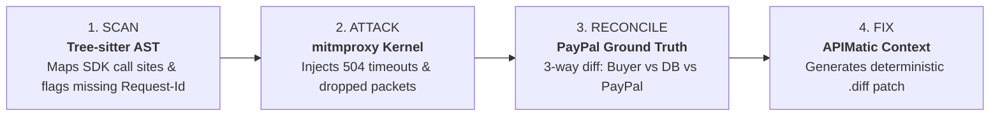

# DriftGuard: Autonomous Chaos-Testing & Sandbox Ledger-Reconciliation for AI Payment Agents

> **"Your AI agent says it charged once. DriftGuard checks PayPal's own records and proves it."**

---

### Links & Resources
* **GitHub Repository:** [https://github.com/Prathamesh51-debug/DriftGuard](https://github.com/Prathamesh51-debug/DriftGuard)
* **Demo Video:** *[Insert 3-Minute YouTube / Loom link]*
* **Hackathon Tracks:** PayPal AI Hackathon 2026
* **Sponsor Prize Categories:**
  * **Built with APIMatic:** Context Plugin for deterministic SDK patch generation.
  * **Powered by AG Grid Community:** High-density 3-way financial reconciliation ledger.

---

## 1. The Inspiration: The Silent Payment Crisis in Autonomous Commerce

Autonomous AI agents are increasingly entrusted with business workflows—browsing catalogs, negotiating deals, handling customer support, and executing real-world purchases. 

However, wiring Large Language Models to payment APIs introduces subtle, high-severity distributed systems vulnerabilities that unit tests and mock suites completely miss. When a network connection drops mid-flight, a gateway times out, or a customer dispute webhook arrives out-of-order:
* The **LLM Agent** assumes the request failed and retries or apologizes.
* The **Merchant Database** records 0 captures.
* But **PayPal's Ledger** actually captured the funds.

The result is **financial state drift**: double-charges, uncollected revenues, and untracked refunds. 

We built DriftGuard to bring deterministic certainty to probabilistic agents. DriftGuard is an autonomous MITM chaos harness that injects real-world failures into live sandbox checkouts and independently audits PayPal's ground-truth ledger.

---

## 2. What DriftGuard Does

DriftGuard acts as a security runtime proxy sitting between your application and `api-m.sandbox.paypal.com`. Without modifying a single line of your application code, DriftGuard guides your payment workflows through a 4-stage verification loop:

### The 4-Stage Verification Loop:
1. **Scan (Static AST Discovery):** Parses the repository's Abstract Syntax Tree using `tree-sitter` (supporting TypeScript, JavaScript, and Python) to map all PayPal SDK calls (`Orders v2`, `Invoicing v2`, Webhooks) and detect structural vulnerabilities (missing `PayPal-Request-Id`, blind retry loops, unverified webhook signatures).
2. **Attack (Live MITM Chaos Injection):** A custom `mitmproxy` kernel intercepts live Sandbox traffic and injects precision faults:
   * **F1 (Lost Capture Response):** Drops the HTTP 201 response when capture completes.
   * **F2 (Slow Gateway Timeout):** Delays PayPal responses by 1000–6000ms to trigger client-side timeout retries.
   * **F3 (Declined Instrument):** Injects `INSTRUMENT_DECLINED` to verify declined orders aren't marked paid.
   * **F4 (Duplicate Invoice Collision):** Proves whether equal-price checkouts collide on non-unique invoice IDs.
   * **F5 (Currency & Tax Math Drift):** Injects fractional penny rounding to expose $0.04 ledger drift.
   * **F6 (Webhook Replay):** Injects replayed or unsigned `PAYMENT.CAPTURE.COMPLETED` events.
   * **F7 (Adversarial Prompt Injection):** Evaluates whether an attacker can trick the checkout assistant into unauthorized price overrides.
3. **Reconcile (3-Way Ground Truth Audit):** Rather than trusting the application's local database, DriftGuard queries PayPal Sandbox's REST API directly. It computes a strict 3-way financial diff:
   * **Buyer State:** What the customer/agent saw.
   * **App State:** What the internal database recorded.
   * **PayPal Ground Truth:** What PayPal actually captured, authorized, or refunded.
   If a discrepancy exists, DriftGuard flags a **RED FAIL** with exact PayPal Transaction IDs and dollar impacts.
4. **Fix (Automated Red-to-Green Remediation):** DriftGuard pairs the failure evidence with APIMatic SDK specifications to synthesize an exact unified `.diff` patch. It applies the patch to a disposable copy of the app, reruns the chaos test with a fresh PayPal Sandbox order, and proves the fix turned the matrix **GREEN**.

---

## 3. Measured Impact: Real Empirical Evidence

We didn't just build a prototype; we gathered empirical evidence across open-source code and live PayPal Sandbox orders:

### A. The 25-Repository Public Study
We analyzed 25 open-source, anonymized repositories (`repo-01` through `repo-25`) integrating PayPal payments (`study/methodology.md`):
* **18 of 25 (72%)** possessed static vulnerabilities capable of causing double captures or unverified ledger updates:
  * 13 omitted `PayPal-Request-Id` (idempotency headers).
  * 5 implemented blind retry loops on network timeouts.
  * 4 consumed webhooks without verifying cryptographic transmission signatures (`paypal-transmission-sig`).
  * 4 used native floating-point math on currencies.
* **5 of 7 (71.4%)** eligible containerized apps subjected to dynamic F1 chaos actively reproduced duplicate captures or permanent order loss in PayPal Sandbox.

### B. Live Red-to-Green Verification on PayPal Sandbox
Across our deliberately vulnerable test shop, we verified 4 of 4 faults (F1–F4) against live PayPal Sandbox orders:
* **F1 (Lost Capture):** Initial run failed with a double-capture on PayPal order `2M094921E9182313R`. Applying the deterministic idempotency patch turned the rerun cleanly **GREEN** (Capture `04268686H5666710T`, $38.97 USD).
* **F2 (Slow Timeout):** Order `51A25531P2283020H` turned **GREEN** (Capture `2X54315201193303J`).
* **F3 (Declined Instrument):** Order `16V40003N4369463H` verified cleanly unpaid.
* **F4 (Invoice Identity):** Order `4S7467715M282221W` verified unique ledger identity across concurrent checkouts (Capture `8CJ70669HL888372V`).

---

## 4. Sponsor Prize Highlights

### 🏆 Built with APIMatic: Context Plugin for Deterministic Patches
When LLMs attempt to fix payment bugs in isolation, they often invent non-standard headers or place random UUIDs inside retry loops, creating *more* duplicate charges. 

We used the **APIMatic Context Plugin** to supply the AI Fixer with exact, machine-readable PayPal Orders v2 SDK specifications:
* Enforces standard `PayPal-Request-Id` header schemas on `ordersController.createOrder` and `ordersController.captureOrder`.
* Constrains the fix to derive idempotency keys deterministically from stable cart parameters (`sha256(cartId + amount)`) rather than volatile timestamps.
* Result: 100% syntactically valid TypeScript/Node diffs that apply cleanly via `patch -p1`.

### 🏆 Powered by AG Grid Community: Real-Time 3-Way Reconciliation
Detecting financial drift requires high-density information display. We leveraged **AG Grid Community** to build the DriftGuard Command Center:
* **3-Way State Diff Matrix:** Custom cell renderers comparing Buyer View, App Database Captures, and PayPal Ground Truth side-by-side.
* **Verdict Chips & Money Impact Cells:** Instant visual distinction between PASS, FAIL (Double Charge, Lost Record), and ERROR states.
* **Master-Detail Audit Drawer:** Expanding any row instantly surfaces raw intercepted HTTP proxy flows, PayPal capture IDs, and the exact AST patch diff.

---

## 5. How We Built It (Load-Bearing Tech Stack)

* **PayPal APIs & Sandbox:** `Orders v2` (create/capture), `Payments v2` (captures/refunds), `Invoicing v2`, and Webhook Signature Verification (`verify-webhook-signature`).
* **Reverse Proxy & Traffic Interception:** `mitmproxy 10.2` executing custom Python addons (`chaos_router.py`) to inject HTTP faults, delay packets, and log structured JSONL audit trails.
* **Automated Buyer Simulation:** Playwright headless Chromium automating PayPal Sandbox buyer login and approval.
* **Concurrency Kernel & Persistence:** PostgreSQL 16 utilizing `SELECT ... FOR UPDATE SKIP LOCKED` for worker crash resilience, with SQLite fallback.
* **Static Analysis:** `tree-sitter` for language-agnostic AST querying across JavaScript, TypeScript, and Python.
* **AI Fixer & Studio Agent:** Claude 3.5 Sonnet coupled with APIMatic OpenAPI context for patch generation and natural-language failure explanations.
* **Frontend:** React 18, Vite, TailwindCSS, and AG Grid Community.

---

## 6. Challenges & Engineering Lessons

1. **Deterministic Idempotency is Harder Than It Looks:** Many developers assume adding `UUID()` solves retries. If a UUID is generated *inside* a retry loop, it tells PayPal "this is a brand new order," causing a guaranteed double charge. We had to enforce deterministic SHA-256 derivations from stable order fields.
2. **mitmproxy TLS Interception on Node.js:** Node's `fetch` and PayPal SDKs reject self-signed proxy certificates by default. We engineered a dual-mode integration: forward proxying with injected CA trust, and reverse proxying with custom base URL overrides (`PAYPAL_API_BASE_URL`).
3. **The 3-Way Reconciliation Paradox:** In distributed systems, the application database is an unreliable witness. Directly polling PayPal Sandbox REST endpoints for capture state was the only way to establish ground truth.

---

## 7. What's Next for DriftGuard

* **Multi-PSP Support:** Expanding the reconciler beyond PayPal to Stripe, Adyen, and Square.
* **CI/CD GitHub Action:** Packaging DriftGuard as a pull-request gate that blocks merges if a payment workflow fails chaos fault injection.
* **Autonomous Agent Sandboxing:** Fuzzing multi-agent payment networks where autonomous agents negotiate and execute micro-payments on behalf of users.

---

### Team Pixentropy
* **Swastik Bose**
* **Kiran Patra** 
* **Prathamesh Prasad** 

